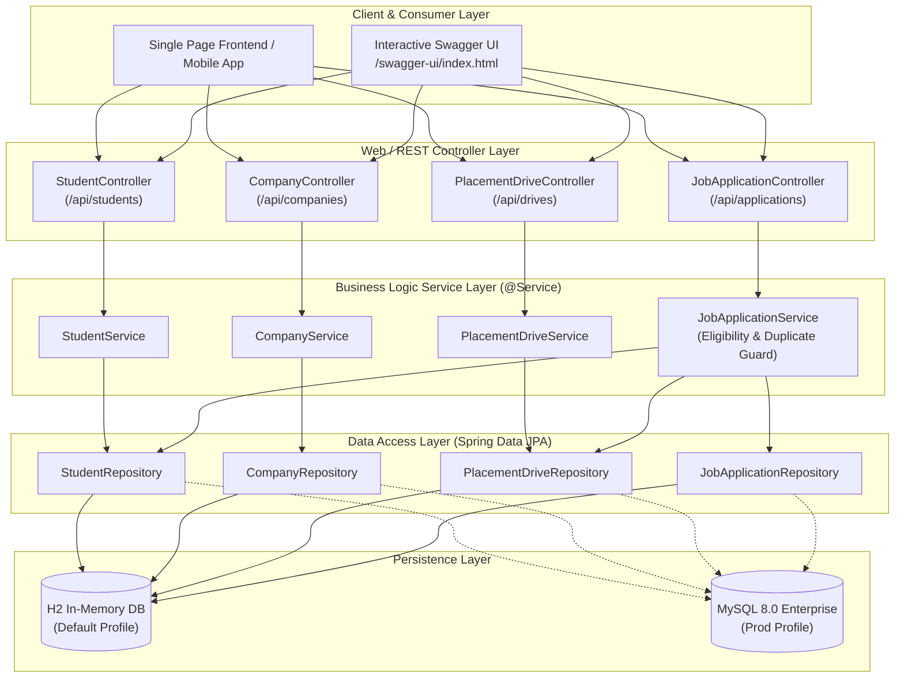

# 🏢 Enterprise Campus Placement Management API

[](https://openjdk.org/)
[](https://spring.io/projects/spring-boot)
[](https://spring.io/projects/spring-data-jpa)
[](https://swagger.io/)
[](https://www.mysql.com/)
[](https://opensource.org/licenses/MIT)

> **A production-grade, enterprise backend RESTful API built with Java 21, Spring Boot 3, and Spring Data JPA for university recruitment management, eligibility automation, and candidate pipeline workflows.**

---

## 📌 Project Overview

The **Campus Placement Management Service** is an enterprise backend system designed to manage large-scale university campus recruitment drives. It automates candidate eligibility filtering, eliminates manual placement coordinator overhead, prevents duplicate submissions, and tracks candidate recruitment pipelines from initial application to offer letter issuance.

### Core Capabilities:
- **Layered Enterprise Architecture:** Clean separation of concerns adhering to the Controller-Service-Repository pattern.
- **Server-Side Eligibility Engine:** Automatic validation of academic CGPA thresholds and qualifying degree branches before accepting applications.
- **Dual Database Profiles:** In-memory **H2 Database** enabled by default for instantaneous zero-setup local execution and testing, plus **MySQL 8.0** for production deployment.
- **Interactive Swagger / OpenAPI 3:** Live interactive documentation and API testing sandbox accessible via browser.
- **Automated Test Coverage:** Comprehensive test suite featuring Mockito unit tests and Spring Boot integration tests.
- **Containerization Ready:** Multi-stage `Dockerfile` and `docker-compose.yml` for containerized deployments.

---

## 🏛️ System Architecture



---

## 📡 REST API Reference

### 1. Students (`/api/students`)
| Method | Endpoint | Description |
|---|---|---|
| `GET` | `/api/students` | Retrieve all registered students |
| `GET` | `/api/students/{id}` | Get student profile by ID |
| `GET` | `/api/students/eligible?minCgpa=7.5` | Filter students meeting CGPA cutoff |
| `GET` | `/api/students/branch/{branch}` | Filter students by degree branch |
| `POST` | `/api/students` | Register a new student profile |
| `PUT` | `/api/students/{id}` | Update existing student profile |
| `DELETE` | `/api/students/{id}` | Remove student profile |

### 2. Companies (`/api/companies`)
| Method | Endpoint | Description |
|---|---|---|
| `GET` | `/api/companies` | List all corporate recruiters |
| `GET` | `/api/companies/{id}` | Get company profile by ID |
| `GET` | `/api/companies/industry/{industry}` | Filter recruiters by industry sector |
| `POST` | `/api/companies` | Register new corporate recruiter |
| `PUT` | `/api/companies/{id}` | Update company details |
| `DELETE` | `/api/companies/{id}` | Remove company profile |

### 3. Placement Drives (`/api/drives`)
| Method | Endpoint | Description |
|---|---|---|
| `GET` | `/api/drives` | Fetch all recruitment drives |
| `GET` | `/api/drives/active` | Fetch open recruitment drives |
| `GET` | `/api/drives/{id}` | Get placement drive details by ID |
| `GET` | `/api/drives/company/{companyId}` | Get drives posted by specific company |
| `GET` | `/api/drives/eligible?cgpa=8.0` | Query drives student qualifies for based on CGPA |
| `POST` | `/api/drives` | Author a new campus recruitment drive |
| `PATCH` | `/api/drives/{id}/status?status=CLOSED` | Update drive status (`OPEN` / `CLOSED`) |

### 4. Job Applications (`/api/applications`)
| Method | Endpoint | Description |
|---|---|---|
| `GET` | `/api/applications` | List all student applications |
| `GET` | `/api/applications/student/{studentId}` | Retrieve application history for student |
| `GET` | `/api/applications/drive/{driveId}` | List applicants for specific drive |
| `POST` | `/api/applications` | Submit application (`studentId`, `driveId`) with eligibility check |
| `PATCH` | `/api/applications/{id}/status?status=INTERVIEW` | Advance candidate stage (`APPLIED`, `SHORTLISTED`, `INTERVIEW`, `SELECTED`, `REJECTED`) |

---

## 🚀 Quickstart Guide

### 1. Prerequisites
- **Java 21 LTS** or newer
- **Maven 3.8+** (or use bundled `./mvnw`)

### 2. Run Locally (Zero Setup with In-Memory H2)
No database installation needed! Run out of the box:

```bash
# Clone the repository
git clone https://github.com/dhruvsingh29-Driod/placement-management-spring-boot.git
cd placement-management-spring-boot

# Run using Maven wrapper (Windows)
mvnw.cmd spring-boot:run

# Run on macOS/Linux
./mvnw spring-boot:run
```

Once running:
- **Interactive Swagger UI:** Open [http://localhost:8080/swagger-ui/index.html](http://localhost:8080/swagger-ui/index.html)
- **H2 Database Web Console:** Open [http://localhost:8080/h2-console](http://localhost:8080/h2-console) (JDBC URL: `jdbc:h2:mem:placement_db`, User: `sa`, Password: empty)

---

## 🧪 Automated Testing

Execute the unit and integration test suite:

```bash
mvnw.cmd test
```

### Test Coverage Highlights:
- **`StudentServiceTest`**: Mockito unit tests validating isolation, exception handling, and duplicate constraint checks.
- **`PlacementWorkflowIntegrationTest`**: Full Spring Boot test validating end-to-end applicant submission, CGPA cutoff rejection, and stage progression.

---

## 🐳 Docker Deployment

Run with production MySQL 8.0 container:

```bash
docker compose up --build
```

---

## 📜 License
This project is licensed under the MIT License.
